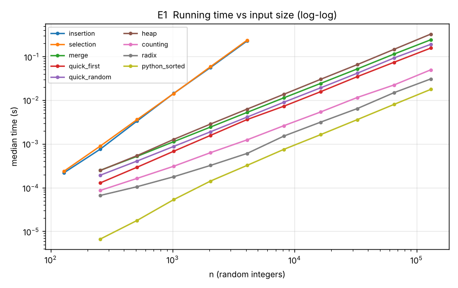
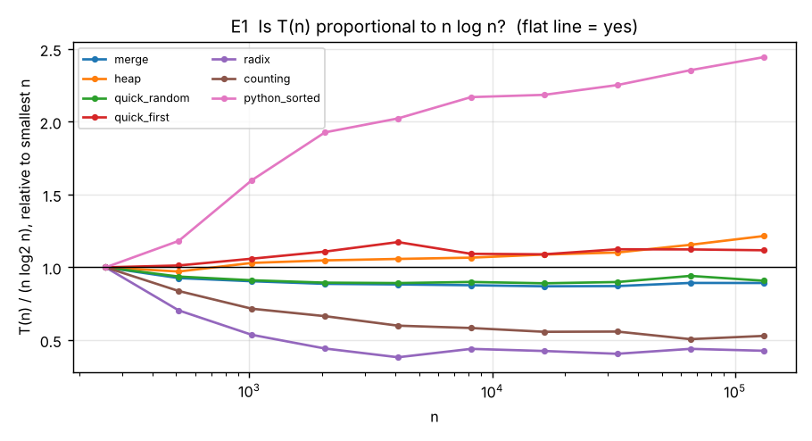
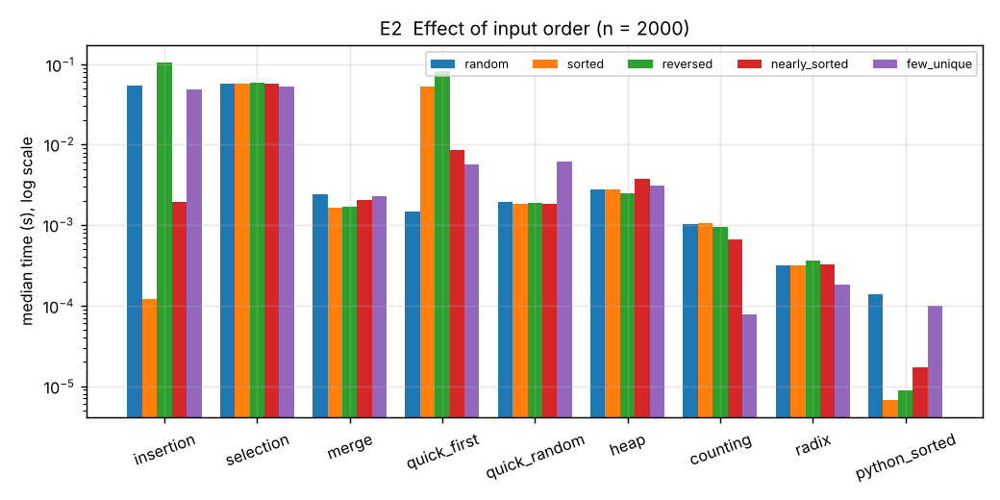
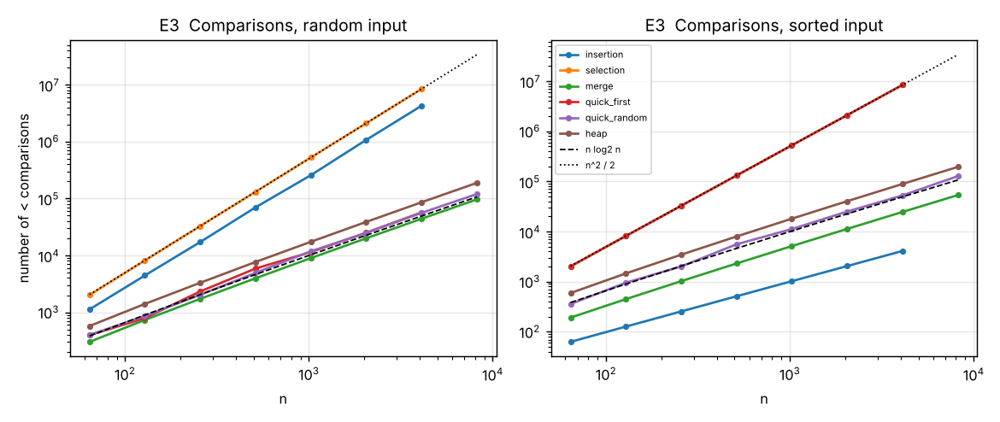
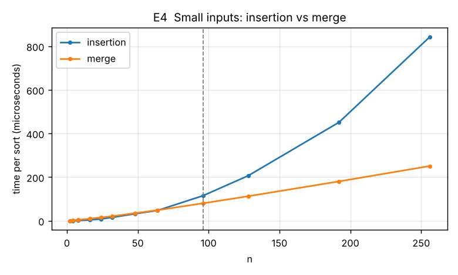
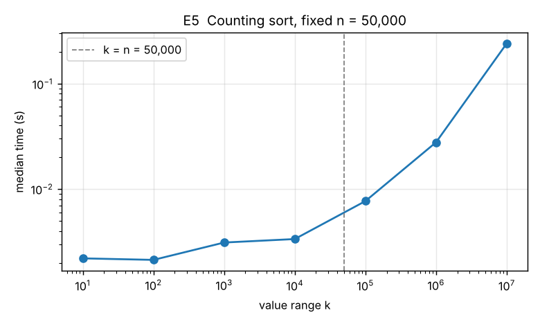
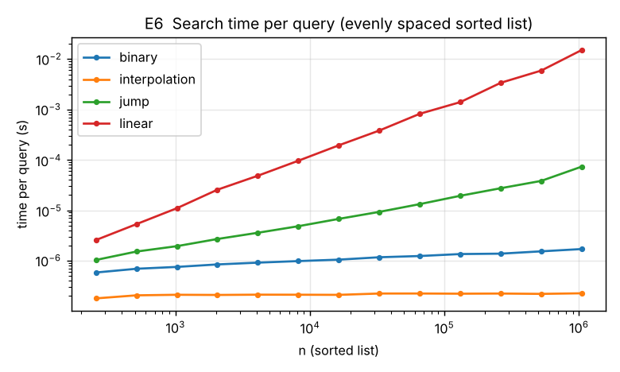
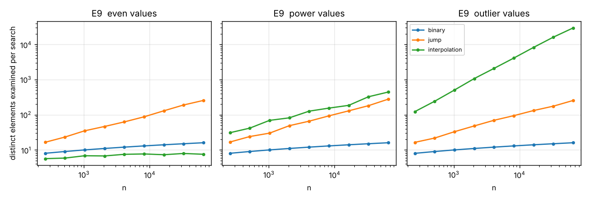

# AI 230 Project 1: Complexity Laboratory

Shafkat Khalek Khan. AI 230 Introduction to Algorithms, Prof. Yair Chaya, Fall 2026.

## 1. Summary

I wrote eight sorting algorithms and four search algorithms from scratch in Python, tested them (126 automated tests, all passing), and timed them with my own benchmarking harness in nine experiments.

The main result is that the asymptotic analysis predicts the number of operations very well, but predicts running time only roughly. Comparison counts matched the formulas exactly in the deterministic cases. For example, merge sort on random input made 96,186 comparisons for n = 8,192, and the average-case formula gives 96,174. Running times followed the predicted growth rates, but the machine added things the model leaves out:

* the cost of one operation differs by about 4.5× between algorithms;
* Python's built-in sort, written in C, was 13.7× faster than my merge sort with the same complexity;
* insertion sort beat merge sort for small inputs (up to n = 64);
* the same algorithm ran up to 868× faster or slower depending on the order of the input;
* counting sort, radix sort and interpolation search depend on properties of the values, not only on n;
* at large n, the cost per operation of some algorithms went up, which fits the effect of CPU caches.

## 2. What I implemented

All code is in `complexity_lab/`. Each sort returns a new sorted list and does not change its input.

| Algorithm | Function | Predicted time | Extra space | Notes |
|---|---|---|---|---|
| Insertion sort | `sorting.insertion_sort` | best Θ(n), average and worst Θ(n²) | in place | stable |
| Selection sort | `sorting.selection_sort` | Θ(n²) for every input | in place | always n(n−1)/2 comparisons |
| Merge sort | `sorting.merge_sort` | Θ(n log n) for every input | Θ(n) | stable; T(n) = 2T(n/2) + Θ(n) |
| Quicksort, first element as pivot | `sorting.quick_sort_first` | average Θ(n log n), worst Θ(n²) | O(log n) stack | worst case on sorted input |
| Quicksort, random pivot | `sorting.quick_sort_random` | expected Θ(n log n) for every input | O(log n) stack | Lomuto partition |
| Heap sort | `sorting.heap_sort` | Θ(n log n) for every input | in place | heap built bottom-up in O(n) |
| Counting sort | `sorting.counting_sort` | Θ(n + k), k = range of values | Θ(n + k) | integers only |
| Radix sort (LSD, base 256) | `sorting.radix_sort` | Θ(d(n + b)), d digits, b = 256 | Θ(n + b) | integers, negatives allowed |
| Linear search | `searching.linear_search` | Θ(n) worst | O(1) | works on unsorted lists |
| Binary search | `searching.binary_search` | Θ(log n) worst | O(1) | returns the leftmost match |
| Jump search | `searching.jump_search` | Θ(√n) worst | O(1) | jumps √n positions at a time |
| Interpolation search | `searching.interpolation_search` | O(log log n) average on evenly spread numbers, Θ(n) worst | O(1) | guesses the position from the value |

"In place" means the algorithm itself needs O(1) extra memory. My functions first copy the input (O(n)) so that the same input can be reused for every timing run.

Some design decisions:

* Quicksort recurses on the smaller part and loops on the larger part. This keeps the recursion depth at O(log n) even when the running time is Θ(n²), so I could measure the worst case without hitting Python's recursion limit.
* Counting sort raises an error when the range of values is above 10⁷. I added this after my first test run: one test sorted `[10⁹, 0, 10⁹−1, 1]`, and counting sort tried to create a billion counters for four numbers. The test run stalled. This is the k in Θ(n + k) in practice.
* Radix sort handles negative numbers by sorting their absolute values separately and putting them in front, reversed.

## 3. Testing

`tests/test_algorithms.py` has 126 pytest tests, and they all pass. Every sort is compared with Python's `sorted()` on edge cases (empty list, one element, two elements in both orders, all values equal, negative numbers, already sorted, reversed, many duplicates, values up to 10⁹) and on 200 random lists. The tests also check that the input list is not changed, that insertion sort and merge sort are stable, and that the comparison sorts work on strings and floats. Every search is checked against `list.index` on 300 random cases, on every element of lists whose sizes are around perfect squares (where jump search could go wrong), on skewed values, and on boundary cases. I also wrote a separate stress test, `tests/stress_check.py`, that runs every sort on 3,000 more random lists and every search on 20,000 more random queries. It found no errors.

## 4. How I measured

* Machine: Intel(R) Xeon(R) Processor, 2 logical CPUs, Linux-6.18.44-fc-v153-x86_64-with-glibc2.39, CPython 3.13.16. It is a shared cloud virtual machine, so other users' work can add noise.
* Timer: `time.perf_counter()`. The garbage collector is turned off while a run is timed. Every point is the median of several runs (3 to 5 for the sorting experiments, 21 for the small-input experiment E4). One search takes less than a microsecond, so for searches I time a batch of queries and divide by the number of queries.
* Inputs: random integers with a fixed seed for each experiment, so every run uses the same inputs. Values are in [0, 10n) unless stated otherwise. For input order I used five kinds: random, sorted, reversed, nearly sorted (1% of positions swapped) and few unique (only 10 different values).
* Counting operations: all my comparison sorts use only `<`. I wrap each element in a small class that counts calls to `<`, which gives the exact number of comparisons. For searches I count how many different positions of the list were read.
* Growth rate: I fit a straight line to log(time) against log(n). If time grows like n^p, the slope is p. For n log n the slope is not exactly 1: over n = 256 to 131,072, the slope of n log₂ n itself is 1.119, so that is the value to compare with.
* Sizes: the Θ(n²) sorts from n = 128 to 4,096, the other sorts from 256 to 131,072, doubling each time.

## 5. Results

### E1. Running time against n (random input)



| Algorithm | n | Slope (all sizes) | Slope (larger half) | Time at largest n |
|---|---|---|---|---|
| insertion | 128 to 4,096 | 2.026 | 1.994 | 228.83 ms |
| selection | 128 to 4,096 | 2.000 | 2.027 | 238.34 ms |
| merge | 256 to 131,072 | 1.106 | 1.105 | 242.73 ms |
| quick_first | 256 to 131,072 | 1.136 | 1.107 | 156.74 ms |
| quick_random | 256 to 131,072 | 1.111 | 1.107 | 190.87 ms |
| heap | 256 to 131,072 | 1.149 | 1.143 | 327.71 ms |
| counting | 256 to 131,072 | 1.023 | 1.055 | 49.79 ms |
| radix | 256 to 131,072 | 1.011 | 1.093 | 30.83 ms |
| python_sorted | 256 to 131,072 | 1.251 | 1.142 | 17.77 ms |

Predicted slopes: 2 for Θ(n²), 1.119 for n log n over this range, 1 for Θ(n).

Insertion sort (2.026) and selection sort (2.000) are quadratic, as predicted. Merge sort (1.106) and both quicksorts (1.111 with a random pivot, 1.136 with the first element) are close to the n log n value. First-pivot quicksort only becomes quadratic on ordered input (E2). Heap sort's slope (1.149) is higher than the n log n value. Counting sort (1.023) and radix sort (1.011) are close to linear.



To check the n log n sorts more closely I divided each time by n log₂ n. For a true n log n algorithm this should give a flat line. For the smallest sizes the fixed cost of each call dominates, so I compare from n = 1,024 up. In that range merge sort stays between 106 and 110 ns per n log₂ n, so it is flat. First-pivot quicksort stays between 67 and 74 ns. Randomized quicksort moves between 84 and 89 ns, because its random pivots give a different amount of work in every run. Heap sort's value goes up by 18% from n = 1,024 to the largest n, and Python's `sorted` goes up by 53%. Counting sort and radix sort go down, which is what a linear algorithm divided by n log n should do.

Radix sort's value goes up again at n = 8,192 (12.4 ns at 4,096, 14.3 ns at 8,192). This is because the values go up to 10n, and 10 × 8,192 = 81,920 is the first maximum that needs a third base-256 digit, so every element gets one more pass. Because the values grow with n here, the number of digits d = ⌈log₂₅₆(10n)⌉ also grows. So radix sort is Θ(d·n) in this experiment, not plain Θ(n).

### E2. Effect of input order (n = 2,000)



| Algorithm | random | sorted | reversed | nearly sorted | few unique |
|---|---|---|---|---|---|
| insertion | 53.78 ms | 0.12 ms | 105.29 ms | 1.96 ms | 49.19 ms |
| selection | 57.06 ms | 56.87 ms | 59.42 ms | 57.23 ms | 52.74 ms |
| merge | 2.42 ms | 1.64 ms | 1.68 ms | 2.06 ms | 2.26 ms |
| quick_first | 1.49 ms | 52.04 ms | 81.46 ms | 8.56 ms | 5.71 ms |
| quick_random | 1.92 ms | 1.82 ms | 1.90 ms | 1.82 ms | 6.20 ms |
| heap | 2.75 ms | 2.81 ms | 2.46 ms | 3.78 ms | 3.08 ms |
| counting | 1.05 ms | 1.05 ms | 0.96 ms | 0.67 ms | 0.08 ms |
| radix | 0.32 ms | 0.32 ms | 0.36 ms | 0.33 ms | 0.18 ms |
| python_sorted | 0.14 ms | 0.01 ms | 0.01 ms | 0.02 ms | 0.10 ms |

* Insertion sort takes 0.12 ms on sorted input and 53.78 ms on random input (444× faster). On sorted input the inner loop never runs, so the cost is Θ(n). Reversed input is its worst case, with n(n−1)/2 shifts instead of about n²/4, and it took 2.0× as long as random input. Nearly sorted input (1.96 ms) is much closer to the best case than to random input.
* Selection sort takes about the same time on every input (52.74 ms to 59.42 ms), because it always scans the whole unsorted part.
* First-pivot quicksort becomes quadratic on sorted (52.04 ms) and reversed (81.46 ms) input, compared with 1.49 ms on random input. Sorted and reversed input both cause exactly n(n−1)/2 comparisons, but reversed input took longer. I counted the swaps to find out why: at n = 2,000 there were 0 swaps on sorted input and 978,552 on reversed input. On sorted input the pivot is always the smallest value, so `a[j] < pivot` is never true and nothing is swapped.
* Randomized quicksort does not depend on the order (1.82 ms on sorted input, 1.92 ms on random input). It was slower on input with only 10 different values (6.20 ms). My partition puts every element equal to the pivot on the same side, so with many equal values the parts are very unbalanced. At n = 2,000 it made 206,634 comparisons on that input and 27,185 on random input. That is close to (1/10)·n(n−1)/2 = 199,900, so it behaves quadratically inside each group of equal values. A three-way partition would fix this.
* Merge sort (1.64 ms to 2.42 ms) and heap sort (2.46 ms to 3.78 ms) change much less with the order than insertion sort or first-pivot quicksort, as their Θ(n log n) bounds for every input predict.
* Python's `sorted` (Timsort) is fastest on sorted input (6.69 µs against 137.15 µs) because it detects runs that are already in order.

### E3. Counting comparisons



| Algorithm / input | n | Comparisons | ÷ n log₂ n | ÷ n(n−1)/2 | Prediction |
|---|---|---|---|---|---|
| insertion / random | 4,096 | 4,244,489 | 86.354 | 0.5061 | about n²/4 (÷ n²/4 = 1.012) |
| insertion / sorted | 4,096 | 4,095 | 0.083 | 0.0005 | exactly n − 1 |
| selection / any | 4,096 | 8,386,560 | 170.625 | 1.0 | exactly n(n−1)/2 |
| merge / random | 8,192 | 96,186 | 0.903 | | about n log₂ n − 1.26n = 96,174 |
| merge / sorted | 8,192 | 53,248 | 0.5 | | exactly (n/2) log₂ n |
| quick_first / sorted | 4,096 | 8,386,560 | 170.625 | 1.0 | exactly n(n−1)/2 (worst case) |
| quick_random / random | 8,192 | 119,389 | 1.121 | | expected 2(n+1)Hₙ − 4n = 124,344 |
| heap / random | 8,192 | 187,658 | 1.762 | | at most about 2n log₂ n |

The deterministic cases match the formulas exactly. Merge sort on random input is within 0.01% of its average-case formula and insertion sort within 1.2% of n²/4. Randomized quicksort is within 4.0% of its expected value. That count changes from run to run because the pivots are random, and the formula is an average over all pivot choices. Insertion sort made 4,095 comparisons on sorted input and 4,244,489 on random input of the same size, which shows how far apart its best and average cases are.

Putting E1 and E3 together shows where the time goes. I divided each measured time by the number of comparisons. The result is the average time per comparison, including all the other work the algorithm does around each comparison.

| Algorithm | ns per comparison (average over sizes) | Comparisons ÷ n log₂ n (random input) |
|---|---|---|
| merge | 127 | 0.903 |
| quick_first | 58 | 1.157 |
| quick_random | 80 | 1.121 |
| heap | 73 | 1.762 |
| insertion | 51 | 86.354 |
| selection | 28 | 170.625 |

Merge sort makes the fewest comparisons of the n log n sorts (0.903 n log₂ n), but each one costs about 127 ns, because it also slices lists, appends to new lists and allocates memory. First-pivot quicksort makes 1.157 n log₂ n comparisons at about 58 ns each and works in place, so on random input it was the fastest of my comparison sorts (156.74 ms against 242.73 ms for merge sort at n = 131,072). Big-O notation counts operations but not what each one costs, and here the cost per comparison differs by a factor of 4.5.

### E4. Small inputs



| n | 2 | 4 | 8 | 16 | 24 | 32 | 48 | 64 | 96 | 128 | 192 | 256 |
|---|---|---|---|---|---|---|---|---|---|---|---|---|
| insertion (µs) | 0.1 | 0.4 | 1.2 | 3.5 | 8.0 | 15.3 | 31.9 | 47.3 | 114.7 | 206.7 | 451.2 | 842.4 |
| merge (µs) | 0.5 | 1.5 | 4.0 | 9.2 | 15.3 | 20.5 | 34.8 | 48.5 | 79.9 | 112.5 | 180.3 | 250.8 |

Insertion sort was faster than merge sort for every n up to 64, and slower from n = 96 on. Big-O describes what happens as n grows large and ignores constant factors. Merge sort has a much larger constant (function calls, slicing, new lists) than insertion sort's short inner loop, so for small n the Θ(n²) algorithm wins. This is why real sorting routines combine the two. CPython's Timsort uses binary insertion sort for short runs.

### E5. Counting sort and the value range k (n = 50,000)



| k | 10 | 100 | 1,000 | 10,000 | 100,000 | 1,000,000 | 10,000,000 |
|---|---|---|---|---|---|---|---|
| time | 2.22 ms | 2.15 ms | 3.14 ms | 3.38 ms | 7.73 ms | 27.78 ms | 238.38 ms |

With n fixed, the time changes little while k is at most n (2.22 ms at k = 10, 3.38 ms at k = 10,000). After that it grows with k, up to 238.38 ms at k = 10,000,000, which is 107× slower for the same n. The fitted slope for k ≥ n is 0.745 and moves towards 1 as k becomes larger than n. Counting sort is linear in n + k, not in n. At k = 10,000,000 it needed 238.38 ms for 50,000 numbers, while my merge sort sorted 65,536 numbers in 114.27 ms (E1).

### E6 and E7. Search time



E6 searches for random elements of the sorted list 0, 2, 4, …, 2(n−1).

| Search | Slope | Predicted | Time per query at n = 256 | at n = 1,048,576 |
|---|---|---|---|---|
| linear | 1.025 | 1 (Θ(n)) | 2.56 µs | 15.20 ms |
| jump | 0.488 | 0.5 (Θ(√n)) | 1.03 µs | 73.54 µs |
| binary | 0.119 | 0.108 (slope of log₂ n over this range) | 0.58 µs | 1.70 µs |
| interpolation | 0.018 | close to 0 on this list | 0.18 µs | 0.22 µs |

All four slopes match their predictions. At n = 1,048,576, binary search is 8,956× faster than linear search per query. Interpolation search is almost constant here because this list is perfectly evenly spaced, so its first guess is always right. E9 shows what happens on other data. The binary search curve rises smoothly, close to the shape of log₂ n.

E7 shows that for linear search the position of the target matters (n = 1,000,000): first element 0.36 µs, at one quarter 6.13 ms, middle 12.00 ms, last 23.96 ms, not in the list 23.44 ms. The time grows with the position, at about 24 ns per element checked. The worst case (last or missing) takes about twice as long as the average case (middle).

### E9. Elements examined by search, on three kinds of data



I counted how many different positions each search reads, averaged over 100 searches for elements in the list. The three kinds of sorted data are: "even" (n different values drawn uniformly from [0, 10n)), "power" (the values i⁴) and "outlier" (0, 1, …, n−2 and then one huge value, 10¹⁵).

| Search | even | power | outlier |
|---|---|---|---|
| binary | 16.0 | 16.0 | 16.0 |
| jump | 255.9 | 278.0 | 255.3 |
| interpolation | 7.5 | 443.5 | 29,582.9 |

(Average number of elements examined at n = 65,536.)

* Binary search examines about log₂ n elements (16 at n = 65,536, log₂ n = 16) whatever the data looks like.
* Jump search examines about √n elements (256 at n = 65,536, √n = 256).
* Interpolation search depends completely on the data. On evenly spread values it examined only 7.5 elements on average, growing very slowly with n, as O(log log n) predicts (log₂ log₂ n = 4 here). On the i⁴ values it examined 444, which is worse than binary search. With one outlier it examined 29,583 elements on average and up to 65,059 in one search, which is linear (fitted slope 1.00). Because the last value is so large, the formula puts every guess at the first position of the range, so each step removes only one element. Its O(log log n) bound is an average for evenly spread data, not a guarantee.

## 6. Where the theory and the machine disagree, and why

| # | What the theory says | What I measured | Reason |
|-|------|--------|------------|
| 1 | Algorithms with the same complexity cost about the same | Merge sort and quicksort are both Θ(n log n), but a comparison costs about 127 ns in merge sort and 58 ns in quicksort | Big-O counts comparisons. The real cost also includes memory allocation, copying, index arithmetic and function calls (E1, E3). |
| 2 | Only the complexity class matters for large n | Python's built-in `sorted` was 13.7× faster than my merge sort at n = 131,072 | It is written in C, so each step avoids the overhead of the Python interpreter. Big-O does not include the language. |
| 3 | Θ(n log n) is better than Θ(n²) | Insertion sort was faster up to n = 64 | Big-O is about large n and ignores constants. For small n the constants decide (E4). |
| 4 | One complexity per algorithm | Insertion sort's time changed by up to 868× at the same n depending on the input order | Best, average and worst cases are different functions. First-pivot quicksort has its worst case on sorted input, which is common in practice (E2). |
| 5 | Equal comparison counts mean equal time | First-pivot quicksort took 1.6× as long on reversed input as on sorted input, with the same number of comparisons | The comparison count leaves out swaps: 978,552 on reversed input and 0 on sorted input (E2). |
| 6 | Counting sort and radix sort are linear | Counting sort became 107× slower at the same n as k grew. Radix sort jumped when the values needed one more digit | Their bounds contain k and d. Treating these as constants is only right when they are bounded (E1, E5). |
| 7 | Interpolation search is O(log log n) | 29,583 elements examined on average at n = 65,536 with one outlier, against 16 for binary search | That bound assumes evenly spread values. Skewed values make its guesses bad (E9). |
| 8 | Each memory access costs the same | From n = 1,024 up, heap sort's time per n log₂ n rose by 18% and Python's `sorted` by 53%, while merge sort stayed between 106 and 110 ns | My explanation is the CPU cache. The RAM model charges the same for every memory access, but a real CPU is slower when the data no longer fits in its cache. Heap sort jumps between positions i and 2i+1, which uses the cache badly, while merge sort reads its lists in order. I did not measure cache misses, so this is a likely explanation, not a proven one. It could be checked with hardware counters (for example `perf stat`). |
| 9 | Randomized quicksort is Θ(n log n) on every input | 3.2× slower on input with only 10 different values | The analysis assumes the values are distinct. With many equal values my two-way partition is unbalanced (E2). |

## 7. Limitations and what did not work

* All results come from one machine (Intel(R) Xeon(R) Processor, 2 logical CPUs). Other programs running at the same time can disturb single measurements. Taking the median helps but does not remove this. Times will be different on another computer, but the growth rates should be similar.
* Each point is the median of only a few runs (3 to 5 in most experiments) and I did not compute confidence intervals. The effects I discuss are factors of 2 or more, which is much larger than the noise, but small differences (for example between the two quicksorts on random input) should not be read into.
* Python is not a clean model of the hardware. Every integer is an object and every list element is a pointer, so memory effects and interpreter effects are mixed. What I say about caches is an explanation I did not measure directly.
* I stopped the Θ(n²) sorts at n = 4,096 to keep the run time reasonable, so their slopes come from a smaller range.
* My first test run stalled on counting sort (Section 2), which led to the range limit.
* My first seeding code used Python's `hash()`. That value changes every time Python starts, so the inputs would have been different on every run. I replaced it with a CRC32 checksum so the results can be reproduced.
* Interpolation search can return any matching position when there are duplicates (binary and jump search return the leftmost). I documented this and only tested it on lists without duplicates, plus a separate duplicate test that checks the returned position holds the target.

## 8. How to reproduce

```
pip install -r requirements.txt
python -m pytest -q                 # 126 tests
python run_experiments.py           # about 2 to 3 minutes, writes results/*.csv
python make_figures.py              # writes figures/*.png and results/summary.json
python make_report.py               # rewrites REPORT.md with the new numbers
python tests/stress_check.py        # extra random checks, about 1 minute
python demo.py                      # short live demo
```

## 9. Use of generative AI

_Check that this section is accurate and change it if needed before submitting._ I used Claude (Anthropic) as an assistant to help write the code, the tests, the benchmark harness and this report. I read and checked every file, ran the tests and experiments myself, and I can explain every algorithm, decision and result in this report.
